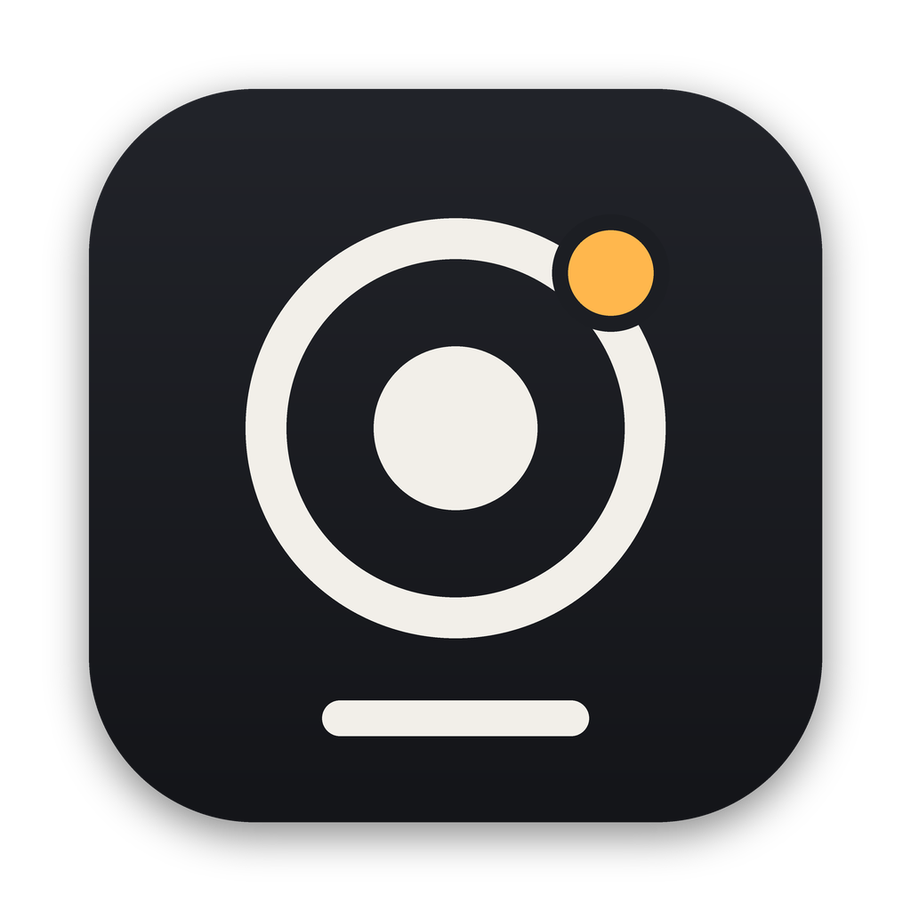
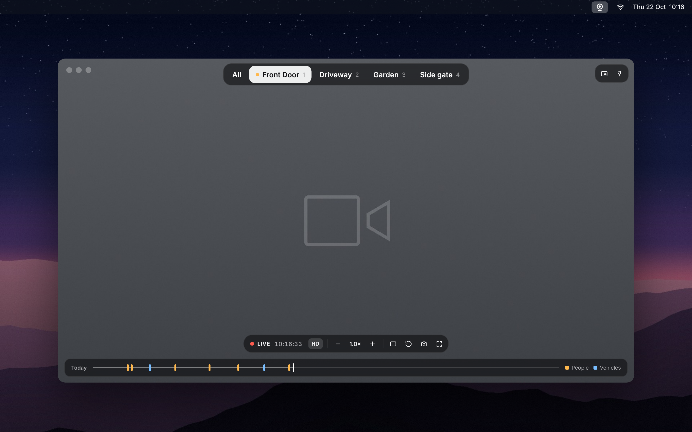
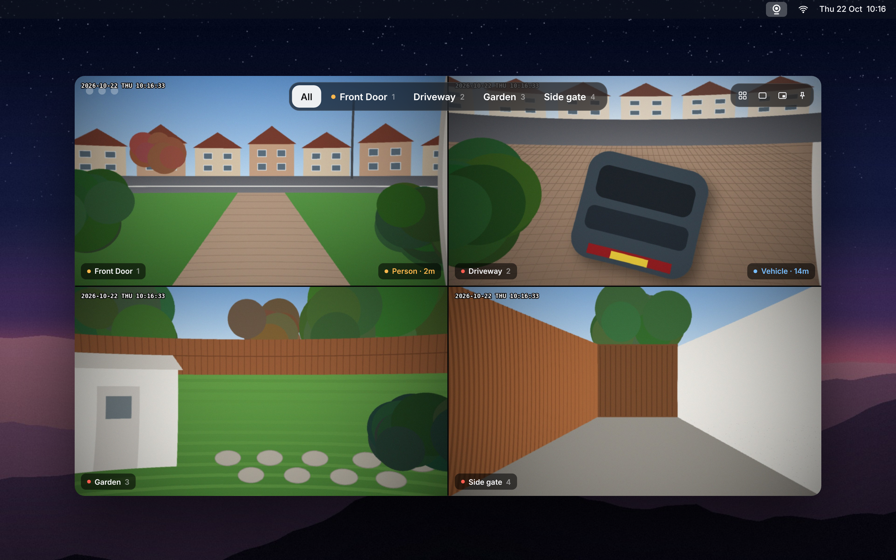
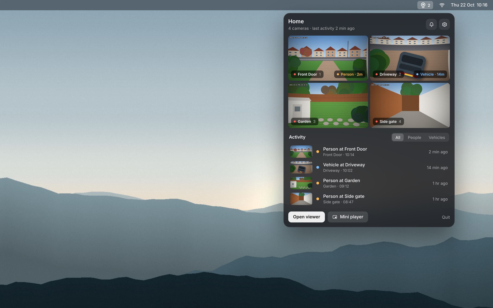
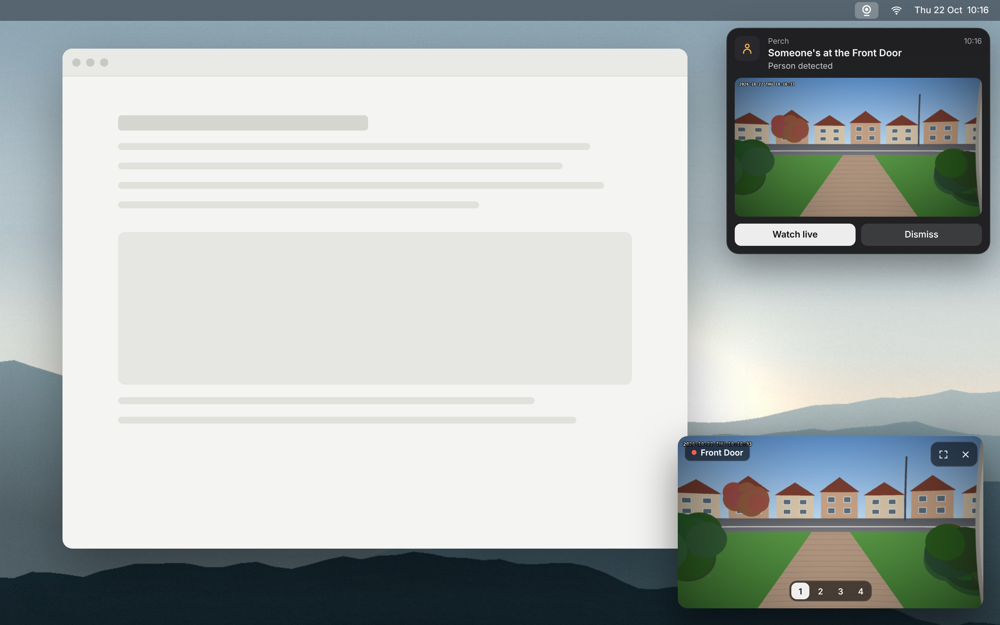

<p align="center">
  
</p>

<h1 align="center">Perch</h1>

<p align="center">A clean, fast macOS app for the cameras on your NVR.<br>Works with Reolink NVRs and cameras, entirely on your home network.</p>

<p align="center">
  
</p>

<table>
  <tr>
    <td></td>
    <td></td>
  </tr>
  <tr>
    <td align="center">All cameras, with the latest detection on each</td>
    <td align="center">The menu bar panel: cameras at a glance and recent activity</td>
  </tr>
  <tr>
    <td colspan="2"></td>
  </tr>
  <tr>
    <td colspan="2" align="center">An alert when someone's detected, and the floating mini player</td>
  </tr>
</table>

<sub>Camera pictures are shown as grey placeholders in these screenshots.</sub>

---

## What it does

- **Menu bar panel** – every camera at a glance, plus recent activity (people, vehicles).
- **Live view** – smooth live video, edge to edge, with controls that get out of the way.
- **All cameras** – automatic, grid, one-large, side-by-side or stacked layouts; choose which cameras show and in what order.
- **Alerts** – a card with a snapshot when someone or something is detected, and one click to watch live.
- **Doorbell alerts** – when someone presses a Reolink video doorbell, Perch chimes, shows who it is and pops the doorbell camera up in the mini player. Comes through even when other alerts are snoozed.
- **Mini player** – a small floating player that stays above your other apps.
- **Today strip** – see when people and vehicles were detected today and jump to the snapshot.
- **Zoom, rotate, pin on top, snapshots**, and keyboard shortcuts for everything.
- **Private by design** – Perch talks straight to your NVR. No cloud, no account, no tracking. Your password is kept in the macOS Keychain.

## Quick start

About 5 minutes. Nothing else to install.

1. **[Download Perch.dmg](../../releases/latest)** and drag Perch into Applications. → [details](#1-download-perch)
2. **Switch on HTTP and RTSP** on your NVR and create a view-only user. → [NVR guide](docs/NVR-SETUP.md)
3. **Open Perch**, enter the NVR's IP address and login, and you're done. → [details](#3-connect)

## Requirements

- macOS 13 Ventura or later (Apple silicon or Intel)
- A Reolink NVR on the same network as your Mac. Wired Reolink cameras and doorbells used on their own should also work.

Not supported: battery-powered Reolink cameras on their own (they sleep to save power and don't offer live streams), and cloud-only setups.

## Install

### 1. Download Perch

Download **Perch.dmg** from the [latest release](../../releases/latest), open it and drag **Perch** into **Applications**.

The first time you open it, macOS will say *"Apple could not verify 'Perch.app' is free of malware"*. That's because Perch isn't signed with a paid Apple developer certificate yet, not because anything is wrong. Click **Done** (not *Move to Bin*), then:

1. Open **System Settings → Privacy & Security**.
2. Scroll down to the **Security** section and click **Open Anyway** next to the message about Perch. (The button appears for about an hour after you first try to open the app. If it's not there, try opening Perch again.)
3. Enter your Mac password and click **Open**. You only need to do this once.

Prefer Terminal? This does the same thing:

```bash
xattr -dr com.apple.quarantine /Applications/Perch.app
```

(Right-click → Open no longer skips this check on recent versions of macOS.)

### 2. Prepare your NVR (once)

Perch needs a few NVR settings switched on. **Full step-by-step guide: [docs/NVR-SETUP.md](docs/NVR-SETUP.md).** In short:

1. **Find the NVR's IP address**, and ideally reserve it in your router so it doesn't change.
2. **Switch on HTTP (port 80) and RTSP (port 554)** under Network › Advanced › Server Settings / Port Settings.
3. **Create a view-only user** for Perch (permission level *User* or *Guest*, not Administrator).
4. **Check smart detection is on** for your cameras (Person / Vehicle), for alerts.
5. *Optional:* set each camera's **I-frame interval to 1x** for faster switching to full quality.

### 3. Connect

Open Perch. Its icon (a small circle with a line under it) appears in the **menu bar** at the top right of your screen. Click it, then the **gear** icon:

1. Enter your NVR's IP address (e.g. `192.168.1.20`), the username and password. If you changed the NVR's HTTP port, add it after a colon, e.g. `192.168.1.20:8080`.
2. Click **Test connection**, then **Save**.

Perch reads your camera list and names from the NVR automatically.

When macOS asks **"Allow Perch to find devices on local networks?"**, click **Allow**. Perch can't reach your NVR without it.

**Can't see the menu bar icon?** On MacBooks with a notch, icons can get hidden when the menu bar is full. Click **Perch** in Applications or the Dock instead: that opens the camera window, and **Settings** is in the menu bar panel. A menu bar organiser such as [Ice](https://github.com/jordanbaird/Ice) also helps.

**Tip:** turn on **Settings → General → Launch at login** so Perch is always there, ready to alert you.

## Using Perch

| Key | Action |
| --- | --- |
| `1`–`9` | Switch camera |
| `G` | All cameras |
| `M` | Mini player |
| `F` | Fit whole picture / crop to fill |
| `R` | Rotate the current camera 90° |
| `S` | Save a snapshot (to Pictures › Perch) |
| `P` | Keep the window on top |
| `0` | Reset zoom |
| `Esc` | Back to live / close |

Scroll or pinch to zoom, drag to move around, double-click to reset.

## Away from home

Perch connects directly to your NVR, so it works on your home network. To use it elsewhere, connect your Mac to home with a private VPN such as [Tailscale](https://tailscale.com) or WireGuard. Don't expose your NVR's ports to the internet.

## Updating

Download the new **Perch.dmg** from [Releases](../../releases/latest), quit Perch (menu bar icon → **Quit**), and drag the new version into Applications, choosing **Replace**. Your settings and cameras are kept.

After an update you may need to click **Open Anyway** again (step 1), and macOS may ask whether Perch can use its saved password in your Keychain: click **Always Allow**.

## Uninstalling

1. Quit Perch and drag it from Applications to the Bin.
2. To remove its data too, delete these folders: `~/Library/Application Support/Perch` and `~/Library/Logs/Perch`.
3. Optionally, open **Keychain Access**, search for **Perch** and delete the saved password.

## FAQ

**Does Perch record?** No. Your NVR keeps recording as normal; Perch is for watching live and getting alerts.

**Does it replace the Reolink app?** For watching and alerts on your Mac, yes. Use the Reolink app for playback of recordings and changing NVR settings.

**Does it cost anything or send my data anywhere?** No and no. It's free, open source, and only talks to your NVR.

**Will it work with more than four cameras?** Yes. Perch reads however many channels your NVR has.

## Troubleshooting

- **"Can't reach the NVR"** – check the IP address, that your Mac is on the same network, and that Perch is allowed in **System Settings → Privacy & Security → Local Network**.
- **Stuck on "CONNECTING"** – check RTSP is switched on (port 554) in the NVR's port settings. Video messages are logged to `~/Library/Logs/Perch/ffmpeg.log`.
- **"NVR refused the login"** – check the username and password, and that the user is allowed to view live video.
- **No detections** – person and vehicle alerts need cameras with Reolink's smart detection. For other cameras, turn on **Any motion** in Settings › Alerts.
- **Date/time overlay won't change** – that setting changes the cameras themselves, so it needs a login that's allowed to change settings.

## Feedback and help

Found a bug or have an idea? [Open an issue](../../issues). Please include your Mac model, macOS version and NVR model.

## Build from source

You'll need Apple's Command Line Tools (`xcode-select --install`).

```bash
git clone https://github.com/addtobag/perch.git
cd perch
bash build-ffmpeg.sh   # once: builds Perch's bundled ffmpeg from source (a few minutes)
bash build.sh          # builds build/Perch.app
bash make-dmg.sh       # builds build/Perch.dmg (Apple silicon + Intel)
```

`make-dmg.sh` can also sign and notarise the app with an Apple Developer ID – see the comments at the top of the script.

## Privacy

Perch only ever connects to the NVR address you enter. Settings are stored on your Mac, the password in the Keychain, and detection snapshots in `~/Library/Application Support/Perch` (kept for 7 days).

## Third-party software

Perch includes [FFmpeg](https://ffmpeg.org) to play live video. FFmpeg is licensed under the [GNU LGPL v2.1 or later](https://www.gnu.org/licenses/old-licenses/lgpl-2.1.html); its licence text ships inside the app (`Perch.app/Contents/Resources/FFmpeg-LICENSE.txt`). The bundled copy is built, unmodified, from the official [FFmpeg 7.1 source](https://ffmpeg.org/releases/ffmpeg-7.1.tar.xz) by [`build-ffmpeg.sh`](build-ffmpeg.sh), with only LGPL components enabled. It's a separate program inside the app (`Perch.app/Contents/MacOS/ffmpeg`), so you can replace it with your own build.

## Disclaimer

Perch is an independent project and is not affiliated with, endorsed by or sponsored by Reolink. Reolink is a trademark of its respective owner.
